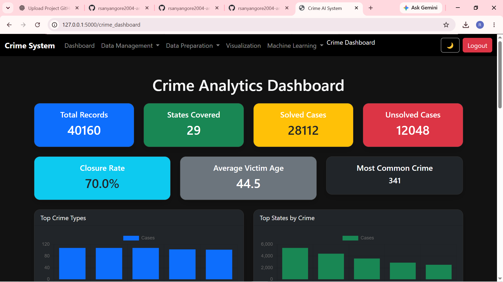
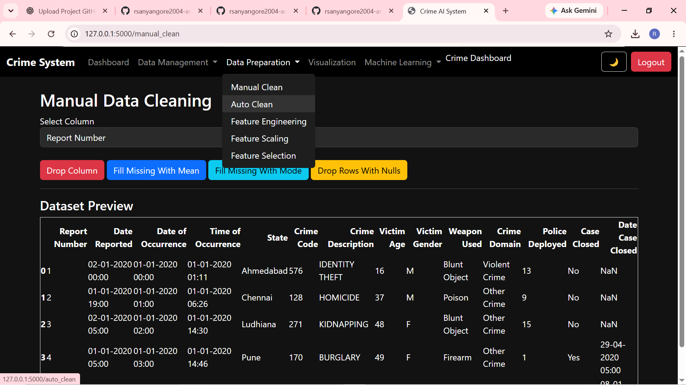
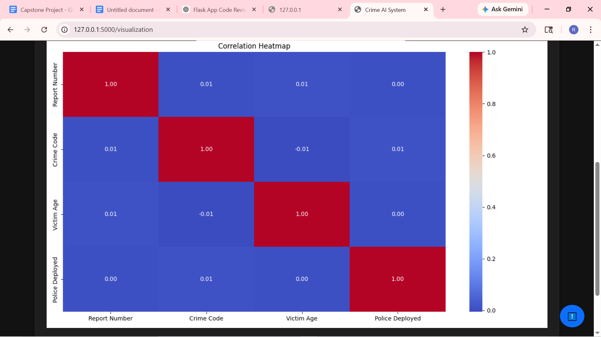
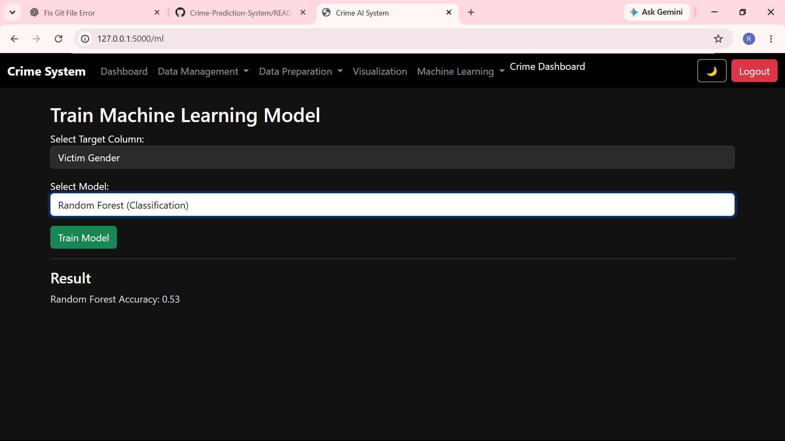
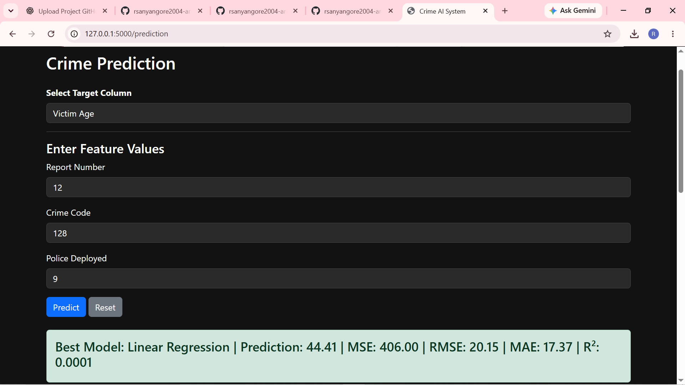

# Crime Prediction and Analysis System

An interactive, machine learning-powered web application designed to analyse crime data, identify crime patterns and generate predictive insights.

## Project Overview

The Crime Prediction and Analysis System is a data science project developed using Python and Flask. It provides an interactive platform for exploring crime datasets, performing data preprocessing, visualising crime trends and applying machine learning algorithms to predict crime-related outcomes.

The project demonstrates the practical application of data analytics, data preprocessing, machine learning and web development in analysing crime patterns.

## Project Objectives

- Analyse historical crime data and identify patterns and trends.
- Provide interactive data exploration and visualisation.
- Perform data cleaning and feature engineering.
- Apply machine learning algorithms to crime-related datasets.
- Compare model performance and identify suitable predictive models.
- Generate predictions using trained machine learning models.

## Key Features

### 1. User Authentication
- User registration and login.
- Password recovery functionality.
- Secure access to the application.

### 2. Data Management
- Upload crime datasets.
- View original datasets.
- Explore dataset structure, dimensions and data types.
- Examine missing values and descriptive statistics.

### 3. Data Preprocessing
- Manual data cleaning.
- Automated handling of missing values.
- Duplicate removal.
- Feature engineering.
- Feature scaling using StandardScaler and MinMaxScaler.
- Feature selection.

### 4. Exploratory Data Analysis
- Interactive data visualisations.
- Crime trend analysis.
- Statistical summaries.
- Graphical exploration of crime patterns.

### 5. Machine Learning
The application supports multiple machine learning algorithms.

**Classification Models**
- Logistic Regression
- Decision Tree Classifier
- Random Forest Classifier
- K-Nearest Neighbours (KNN)

**Regression Models**
- Linear Regression
- Random Forest Regressor
- Decision Tree Regressor
- KNN Regressor

### 6. Model Recommendation and Evaluation
- Model recommendations based on dataset characteristics.
- Comparison of machine learning algorithms.
- Evaluation of model performance.
- Identification of important predictive features.

### 7. Crime Prediction
- Train predictive models.
- Generate predictions using selected models.
- Explore feature importance.

## Technologies Used

| Category | Technologies |
|---|---|
| Programming | Python |
| Backend | Flask |
| Frontend | HTML, CSS, JavaScript |
| Data Analysis | Pandas, NumPy |
| Machine Learning | Scikit-learn |
| Visualisation | Matplotlib, Seaborn |
| Database | SQLite, Flask-SQLAlchemy |
| Development Tools | Visual Studio Code, Git, GitHub |

## Machine Learning Results

The following are the model accuracy results obtained during project evaluation.

| Model | Accuracy |
|---|---:|
| Logistic Regression | 87.4% |
| Decision Tree | 94.8% |
| Random Forest | 97.6% |
| KNN | 91.3% |

**Best-performing model:** Random Forest with 97.6% accuracy.

*Note: These are the observed results from the project evaluation. Performance may vary depending on dataset preparation, features and train-test splitting.*

## Important Features Identified

The analysis highlighted the importance of features such as:

- District
- Crime Type / Crime Category
- Year

These features contributed to understanding geographical and temporal crime patterns.

## Project Structure

```text
Crime-Prediction-System/
│
├── app.py
├── requirements.txt
├── README.md
├── IndiaCrime.csv
│
├── templates/
│   ├── dashboard.html
│   ├── overview.html
│   ├── prediction.html
│   └── ...
│
├── static/
│   ├── css/
│   ├── js/
│   └── images/
│
├── models/
├── screenshot/
└── uploads/
```

## Installation and Setup

### Prerequisites

- Python 3.10 or later
- Git
- Visual Studio Code (recommended)

### 1. Clone the repository

```bash
git clone https://github.com/rsanyangore2004-arch/Crime-Prediction-System.git
```

### 2. Navigate to the project directory

```bash
cd Crime-Prediction-System
```

### 3. Create a virtual environment

```bash
python -m venv venv
```

### 4. Activate the virtual environment

For Windows PowerShell:

```powershell
.\venv\Scripts\Activate
```

### 5. Install dependencies

```bash
pip install -r requirements.txt
```

### 6. Run the application

```bash
python app.py
```

### 7. Open the application

Visit:

```text
http://127.0.0.1:5000
```

## Application Screenshots

Screenshots of the application will be added below.

### Dashboard


### Data Overview


### Data Visualisation


### Machine Learning Results


### Prediction


## Future Improvements

- Deploy the application to a cloud hosting platform.
- Integrate larger and more diverse crime datasets.
- Improve predictive performance through hyperparameter tuning.
- Introduce interactive geographical crime maps.
- Develop advanced forecasting capabilities.
- Enhance dashboard interactivity and reporting.

## Project Information

**Project:** Crime Prediction and Analysis System

**Domain:** Data Science | Machine Learning | Predictive Analytics

**Developed using:** Python, Flask and Scikit-learn

**Repository:** [Crime Prediction System on GitHub](https://github.com/rsanyangore2004-arch/Crime-Prediction-System)

---

*This project demonstrates the practical use of data science and machine learning to explore crime patterns and generate predictive insights.*