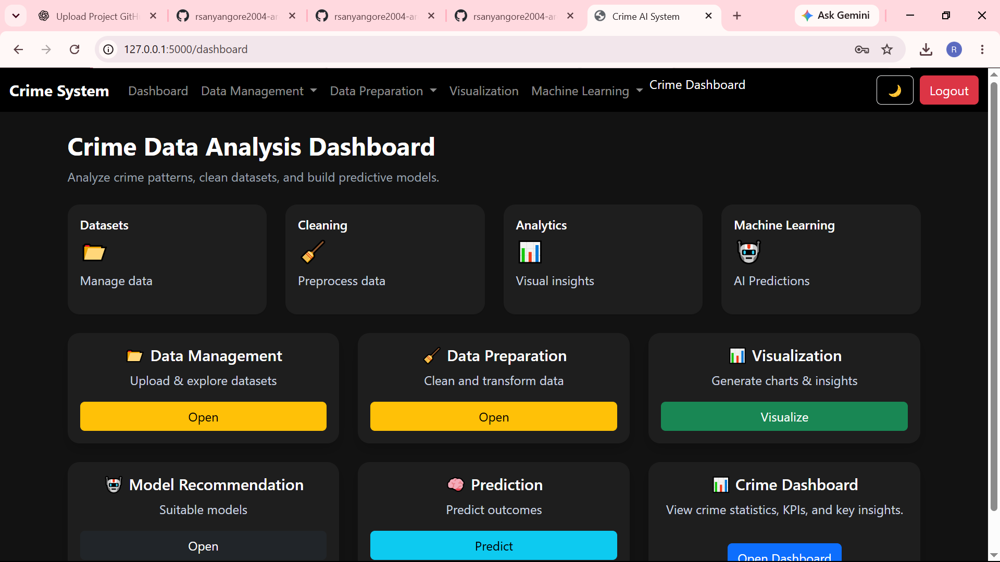

# Crime Prediction System
### Machine Learning-Based Crime Pattern Analysis and Prediction

## Project Overview

The **Crime Prediction System** is a web-based machine learning application developed to analyse historical crime data, identify crime patterns and support data-driven insights.

The system allows users to upload crime datasets, explore and preprocess data, generate visualisations, analyse crime trends, train machine learning models and make predictions.

The application was developed using Python and Flask, with machine learning algorithms from Scikit-learn and data analysis libraries to support the end-to-end analytics process.

## Project Objectives

- Analyse historical crime data to identify patterns and trends.
- Provide interactive data exploration and visualisation capabilities.
- Perform data cleaning and preprocessing.
- Apply machine learning techniques to crime-related datasets.
- Compare multiple predictive models based on their performance.
- Generate predictions and identify important features influencing model outcomes.

## Key Features

### 1. User Authentication
- User registration and login.
- Forgot password functionality.
- Password management.

### 2. Data Management
- Upload crime datasets.
- View original datasets.
- Explore dataset structure and contents.
- Display dataset shape, information, data types and descriptive statistics.

### 3. Data Preparation
- Manual data cleaning.
- Automatic handling of missing values.
- Duplicate record removal.
- Feature engineering.
- Feature scaling using StandardScaler and MinMaxScaler.
- Feature selection.

### 4. Exploratory Data Analysis (EDA)
- Generate data visualisations.
- Explore crime distributions and patterns.
- Analyse crime trends across different years, districts and crime categories.
- Identify relationships between relevant variables.

### 5. Machine Learning
- Recommend suitable machine learning models based on the prediction task.
- Train and compare multiple classification and regression algorithms.
- Evaluate model performance.
- Identify important predictive features.

### 6. Crime Prediction
- Generate predictions using trained machine learning models.
- Explore the influence of selected input features on prediction outcomes.

## Technologies Used

| Category | Technologies |
|---|---|
| Programming Language | Python |
| Web Framework | Flask |
| Frontend | HTML, CSS |
| Data Analysis | Pandas, NumPy |
| Machine Learning | Scikit-learn |
| Data Visualisation | Matplotlib, Seaborn |
| Database | SQLite |
| Development Environment | Visual Studio Code |
| Version Control | Git and GitHub |

## Machine Learning Models

The system supports the following algorithms:

### Classification Models
- Logistic Regression
- Decision Tree Classifier
- Random Forest Classifier
- K-Nearest Neighbors (KNN) Classifier

### Regression Models
- Linear Regression
- Decision Tree Regressor
- Random Forest Regressor
- K-Nearest Neighbors (KNN) Regressor

## Model Performance

The following classification accuracy results were obtained during project testing:

| Machine Learning Model | Accuracy |
|---|---:|
| Logistic Regression | 87.4% |
| Decision Tree | 94.8% |
| Random Forest | **97.6%** |
| K-Nearest Neighbors | 91.3% |

### Key Findings

- Random Forest achieved the highest reported classification accuracy of **97.6%**.
- Decision Tree achieved the second-highest accuracy of 94.8%.
- Logistic Regression and KNN also demonstrated predictive capabilities.
- District, Crime Type/Category and Year were identified as important features in the analysis.

*Note: These are project testing results and may vary depending on the dataset, preprocessing steps and evaluation configuration. Accuracy figures should be interpreted in the context of the test data and class distribution.*

## Project Architecture

The application consists of the following main components:

1. **User Interface:** Provides an interactive interface for users to access the application's functionality.
2. **Flask Backend:** Handles application routing, user requests and system operations.
3. **Data Processing Engine:** Performs dataset loading, cleaning and transformation.
4. **Machine Learning Engine:** Trains and evaluates predictive models.
5. **Visualisation Engine:** Generates graphical representations of crime patterns and trends.
6. **Prediction Module:** Uses trained models to generate predictions.

## Installation and Setup

Follow these instructions to run the project locally.

### Prerequisites

Ensure you have installed:

- Python 3.x
- Git
- Visual Studio Code

### 1. Clone the Repository

```bash
git clone https://github.com/rsanyangore2004-arch/Crime-Prediction-System.git
```

### 2. Navigate to the Project Directory

```bash
cd Crime-Prediction-System
```

### 3. Create a Virtual Environment

```bash
python -m venv venv
```

### 4. Activate the Virtual Environment

For Windows PowerShell:

```powershell
.\venv\Scripts\Activate.ps1
```

### 5. Install Dependencies

```bash
pip install -r requirements.txt
```

### 6. Run the Application

```bash
python app.py
```

### 7. Open the Application

Open your browser and navigate to:

http://127.0.0.1:5000/

The application should now be running locally.

## Dataset

The project uses historical crime data for analysis and predictive modelling.

The dataset is used to explore crime patterns across relevant dimensions, including:

- District
- Crime Type / Category
- Year

Dataset availability and usage are subject to the applicable source and licensing conditions.

## Future Enhancements

Potential improvements include:

- Integration of additional crime datasets from different regions.
- Advanced time-series crime forecasting.
- Interactive geographical crime maps.
- Improved model optimisation and hyperparameter tuning.
- More comprehensive model evaluation and validation.
- Deployment to a cloud hosting platform.

## Learning Outcomes

Through this project, practical experience was gained in:

- Data cleaning and preprocessing.
- Exploratory data analysis.
- Feature engineering and feature selection.
- Machine learning model development.
- Predictive analytics and model evaluation.
- Flask web application development.
- Integrating machine learning models into a web application.
- Version control and project management using Git and GitHub.

## Project Information

- **Project Name:** Crime Prediction System
- **Project Type:** Final-Year Academic Project
- **Development Approach:** Collaborative Development (Pair Project)
- **Repository:** [Crime-Prediction-System](https://github.com/rsanyangore2004-arch/Crime-Prediction-System)
- **Developer:** Rhoda Sanyangore

---

*This project was developed for academic and learning purposes. Its predictions are intended to support analytical exploration and should not be used as the sole basis for policing, criminal investigations or decisions affecting individuals.*


---

## Application Screenshots

The following screenshots demonstrate the main features and functionality of the Crime Prediction System.

### 1. Login Page
[](screenshot/login.png)

### 2. Main Dashboard
[](screenshot/main-dashboard.png)

### 3. Crime Dashboard
[](screenshot/crime-dashboard.png)

### 4. Data Visualisation
[](screenshot/vizualisation.png)

### 5. Data Preparation
[](screenshot/data-preparation.png)

### 6. Model Recommendation
[](screenshot/model-recommendation.png)

### 7. Crime Prediction
[](screenshot/prediction.png)
